# mumh5

A Mumble client with voice chat, rich messages, file transfers, and screen sharing. Available as a Windows or Linux desktop app, or in a browser through a self-hosted proxy.

Connect to an existing Mumble server without installing a plugin or changing its configuration. Friends using the classic Mumble client can join the same voice channels and chats.

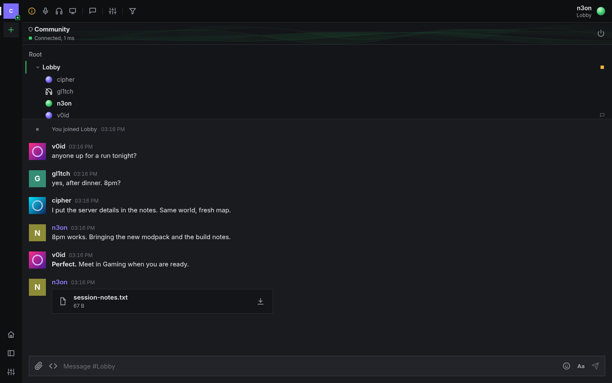

[Download the latest snapshot](https://github.com/licentiapoetica/mumh5/releases/tag/snapshot) · [Host the browser client](docs/self-hosting.md) · [Build from source](docs/development.md)

## Get started

1. **Install a desktop build** from the table below. Snapshots are rolling prerelease builds from successful builds of `main`; checksums are included on the release page.
2. **Create or import an identity.** On first launch, choose a name and create a certificate, import a `.p12` backup, or reuse your Mumble desktop identity. Back it up to keep your server registrations.
3. **Add a server** with the plus button, enter its address and your username, and connect. The desktop app also has a public server browser.
4. **Join a voice channel** with a double click. A single click opens its chat. Choose voice activity, push to talk, or always on in **Settings > Voice**.

| Platform | Download |
| --- | --- |
| Windows x64 | [Installer (.exe)](https://github.com/licentiapoetica/mumh5/releases/download/snapshot/mumh5-win-x64.exe) |
| Linux x64 | [AppImage](https://github.com/licentiapoetica/mumh5/releases/download/snapshot/mumh5-linux-x64.AppImage) — make it executable, then run it |
| Debian / Ubuntu x64 | [Package (.deb)](https://github.com/licentiapoetica/mumh5/releases/download/snapshot/mumh5-linux-x64.deb) |
| Linux x64, portable | [Archive (.tar.gz)](https://github.com/licentiapoetica/mumh5/releases/download/snapshot/mumh5-linux-x64.tar.gz) — includes install and uninstall scripts |

The Windows installer is unsigned, so SmartScreen may warn. Current AppImages bundle a static FUSE runtime. For installation, updates, removal, and older AppImage troubleshooting, see the [desktop installation guide](docs/installation.md). macOS requires a source build on a Mac; automated macOS builds are disabled.

## What you can do

- **Talk:** low-delay voice, noise suppression, echo cancellation, microphone testing, and per-person volume.
- **Chat:** channel and private messages, reactions, code snippets, profile cards, and optional local chat history with configurable retention.
- **Send files:** drag, paste, or attach files up to 2 GB. Transfers pass through the Mumble server; no file-hosting service is needed.
- **Share a screen or camera:** stream to other mumh5 users in your channel, with a preview and quality controls before you start.
- **Manage a community:** create and arrange channels, set permissions and roles, move users, and moderate from their context menus.
- **Choose your layout:** Stacked, Modern, or Classic, plus a Rooms interface for smaller screens. Pick from 100 color schemes and add a background image or pattern.

The [feature reference](docs/features.md) covers voice, text channels, notification sound packs, identities, moderation, and the file-transfer protocol.

## A look around

The default **Stacked** layout puts channels above the conversation. **Modern** places channels on the left and members on the right. **Rooms** provides separate chat, voice, people, and profile screens. Change these in **Settings > Appearance**.

| Modern layout | Rooms interface |
| --- | --- |
| 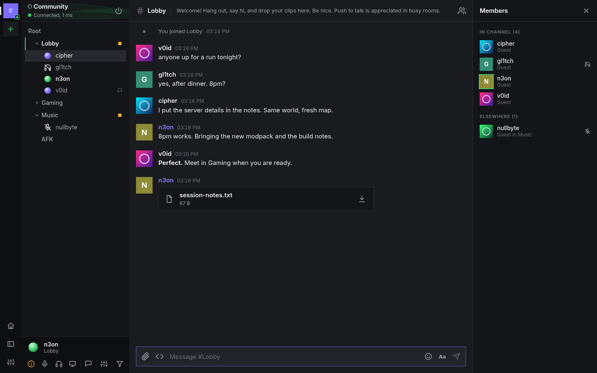 | 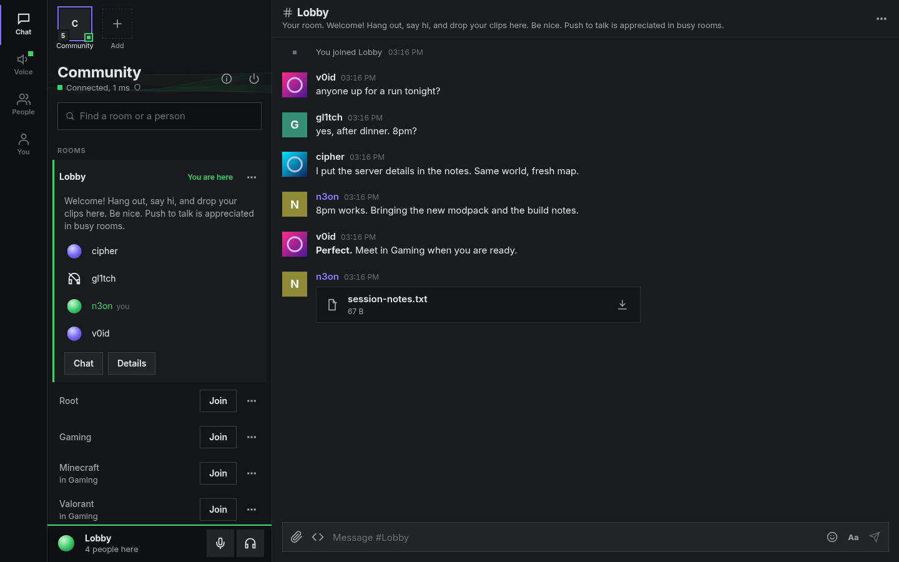 |

| Profile cards | Voice settings |
| --- | --- |
| 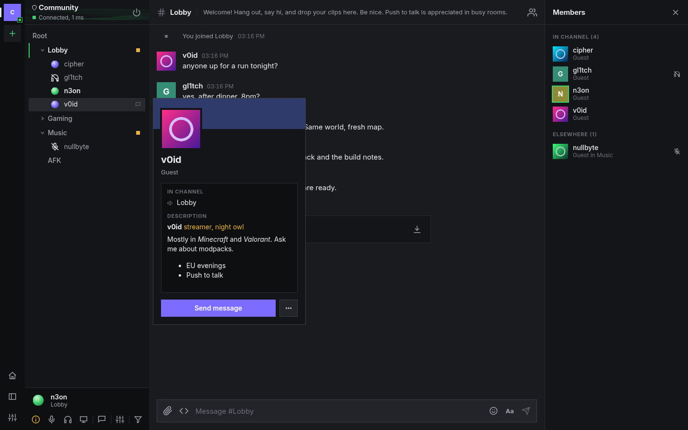 | 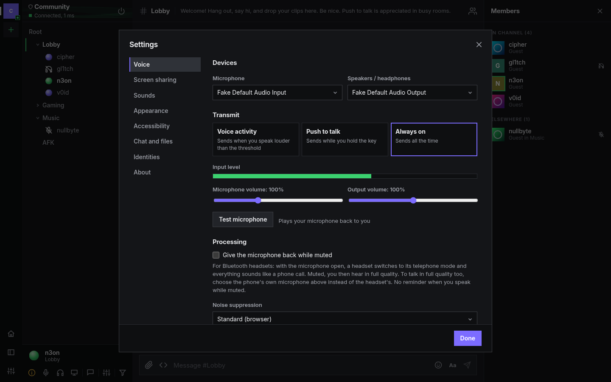 |

Share a screen or window, then let others watch from the channel. A stream can open in its own window. Camera feeds appear in the voice tiles.

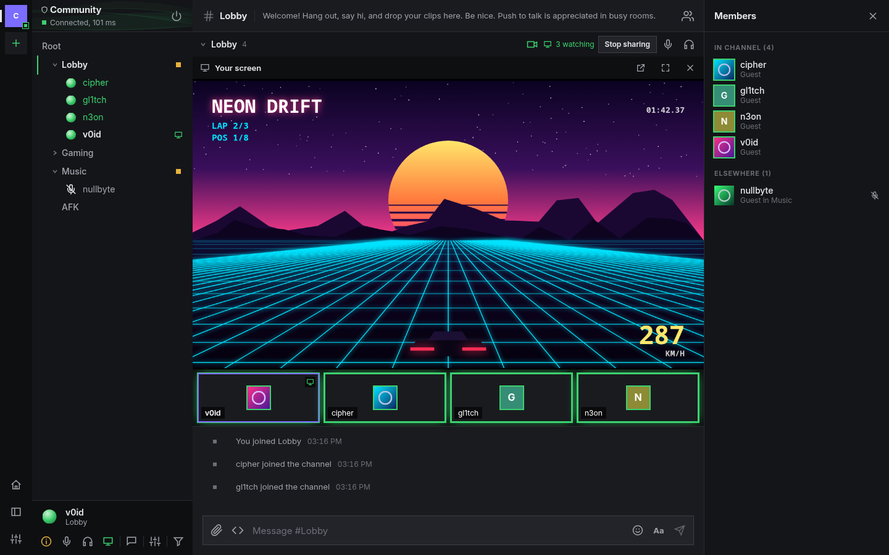

Streams use WebRTC, with up to eight viewers per stream. Direct connections may need STUN across routers; restrictive networks may need a TURN relay. The browser proxy provides both. Desktop clients can configure them in **Settings > Screen sharing**.

| Windows 95 | Light | Frost | Midnight |
| --- | --- | --- | --- |
| 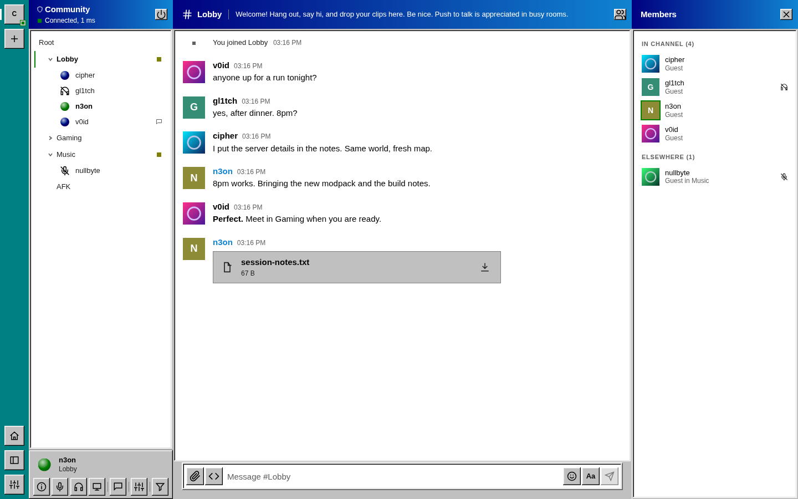 | 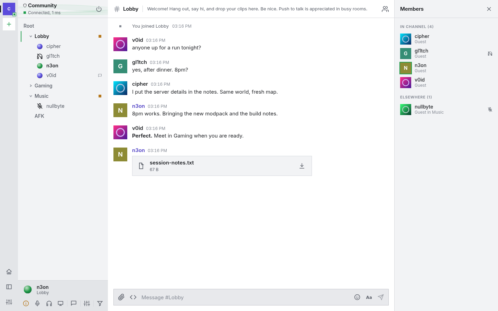 | 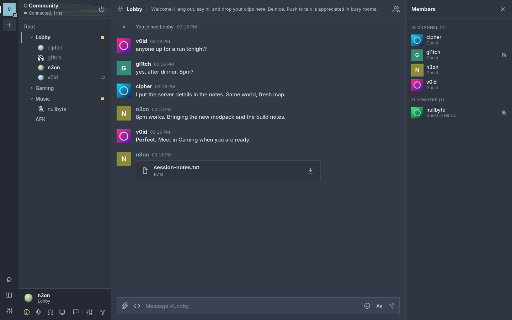 | 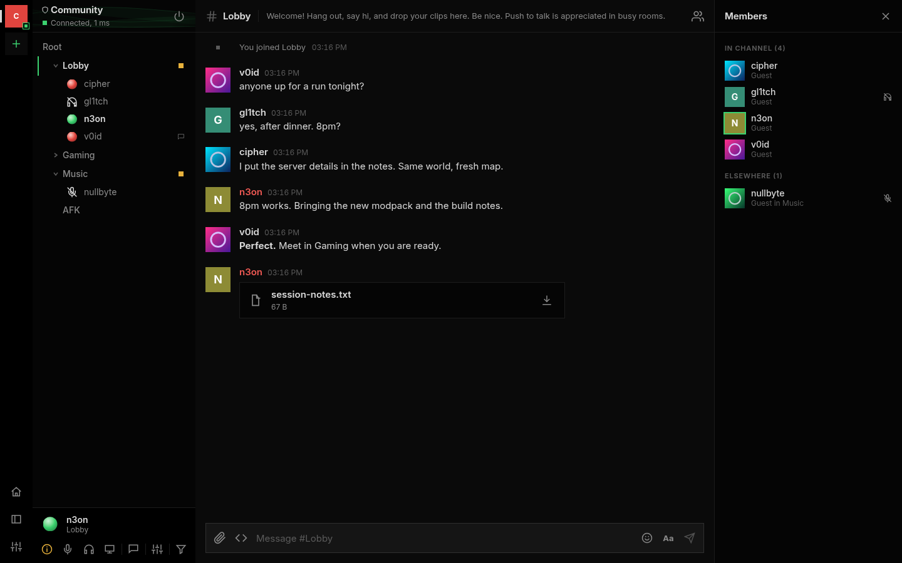 |

The Rooms interface at phone width:

<p align="center">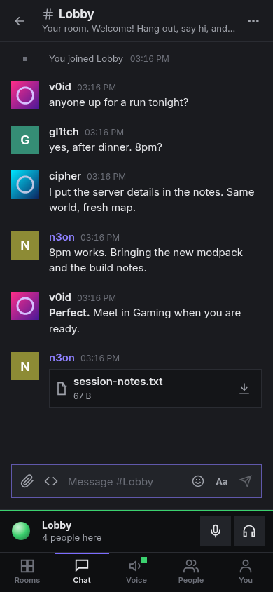</p>

Screenshots use scripted conversations and fresh test clients connected to a local Mumble server. The shared racing scene is a simulated capture source. The [screenshot guide](docs/screenshots/README.md) explains how to reproduce them and what the capture run covers.

## Compatibility and limits

| Feature | Classic Mumble clients | mumh5 clients |
| --- | --- | --- |
| Voice, channels, ordinary messages, avatars | Compatible | Compatible |
| Shared files | Announcement and preview; small inline pictures remain visible | File transfer and media players |
| Screen and camera streams, reactions | Unavailable | Supported between mumh5 users |
| Text channels | Appear as ordinary Mumble channels | Read and write without leaving a voice channel |

File transfers and text channels require Mumble 1.4 or newer; text channels also require HTML messages. Text channels are visible to all mumh5 users on the server, with no private text channels yet. Chat history is opt-in and stored locally; the Mumble server does not retain messages or shared files.

System-wide push to talk, whisper/shout, positional audio, the in-game overlay, recording, and dedicated ban-list and registered-user editors are not implemented. The Rooms interface is still incomplete. See the [feature reference and roadmap](docs/features.md) for details.

## Use it in a browser

The browser build uses a proxy you host to serve the app and bridge WebSocket connections to Mumble. From a [source checkout](docs/development.md):

```bash
npm ci
npm run build:web
MUMH5_SERVERS="mumble.example.com=My server" node dist-proxy/proxy.mjs
```

Open `http://127.0.0.1:8080`. Remote use needs HTTPS for microphone access. The web app can also be installed from a supporting browser; it opens offline, but connecting still requires the proxy.

**Use a proxy you trust.** The browser sends your identity certificate and private key to the proxy on every connection, and your messages and server password pass through it. Voice uses the TCP tunnel rather than UDP. Clearing browser storage removes your identity unless you have a backup.

The [self-hosting guide](docs/self-hosting.md) includes Docker, nginx, the server allowlist, a default server for visitors, STUN/TURN ports, sound-pack limits, and the full environment-variable reference.

## Privacy and identity

- Desktop identities stay on your computer with owner-only file permissions. A password-protected `.p12` backup also works with classic Mumble.
- Server certificates are pinned on first use. If a certificate changes, mumh5 asks before sending your password.
- Incoming message HTML is sanitized. External media requires an allowed host or a click; YouTube players and link previews are off by default.
- Screen-sharing peers can see each other's IP addresses. mumh5 explains this before first use.

## Development

You need Node.js 22 or newer, npm, and Git. CI uses Node.js 26. With the GitHub CLI installed:

```bash
gh repo clone licentiapoetica/mumh5
cd mumh5
npm ci
npm run dev
```

Use `npm run dev:web` for the browser client, `npm run check` for type checking, and `npm test` for unit tests. The [development guide](docs/development.md) covers packaging, real-server tests, screenshots, CI, and the source layout. [CLAUDE.md](CLAUDE.md) documents architecture and project conventions.

## Credits and license

mumh5 is built by **Kibi**, with substantial code, tests, and documentation written using **Claude** in Claude Code. Kibi directs the project and reviews the results. Report problems in the [issue tracker](https://github.com/licentiapoetica/mumh5/issues).

[MIT](LICENSE). Mumble protocol definitions and generated code have a BSD license; see [THIRD_PARTY_NOTICES.md](THIRD_PARTY_NOTICES.md).

mumh5 is not affiliated with the Mumble project. Mumble is a trademark of its respective owners.
