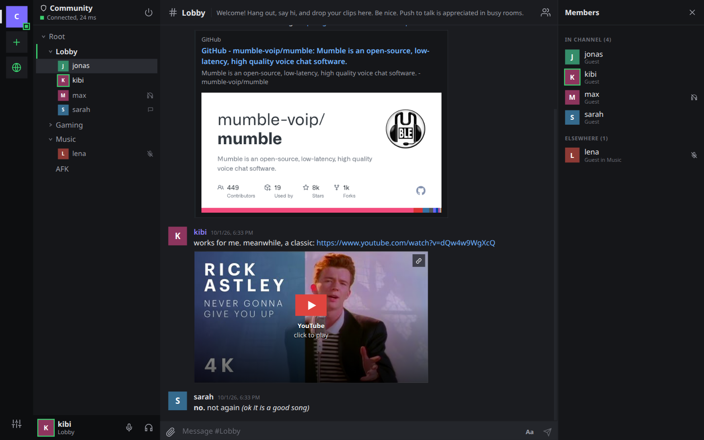
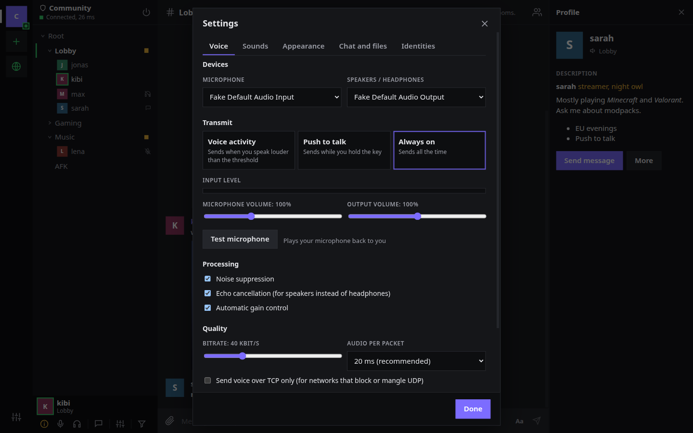
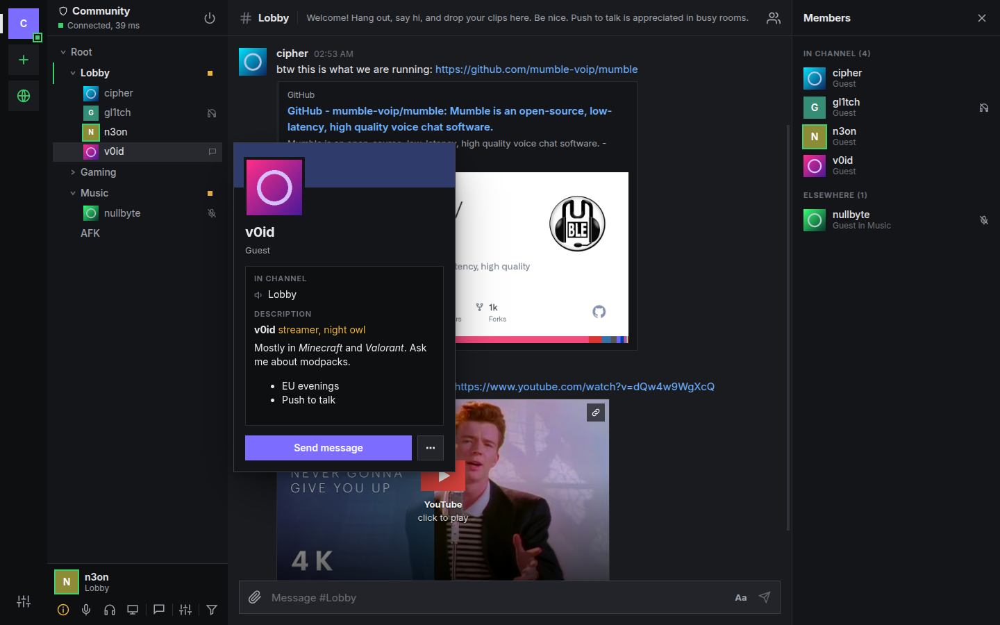
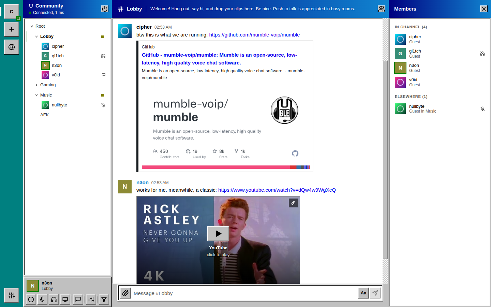
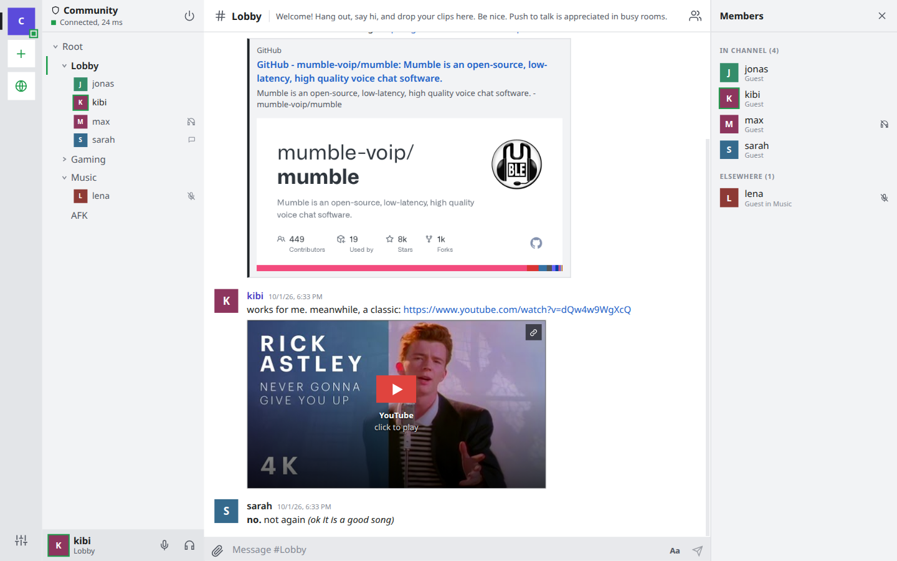
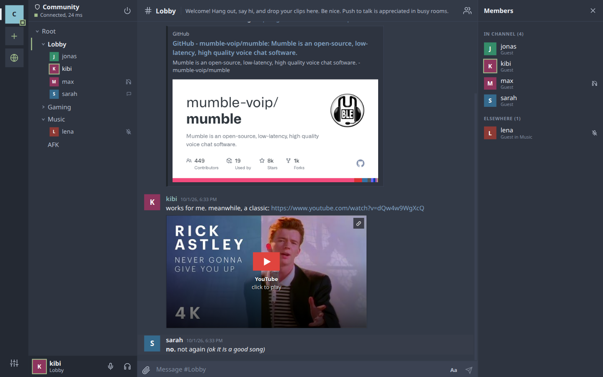
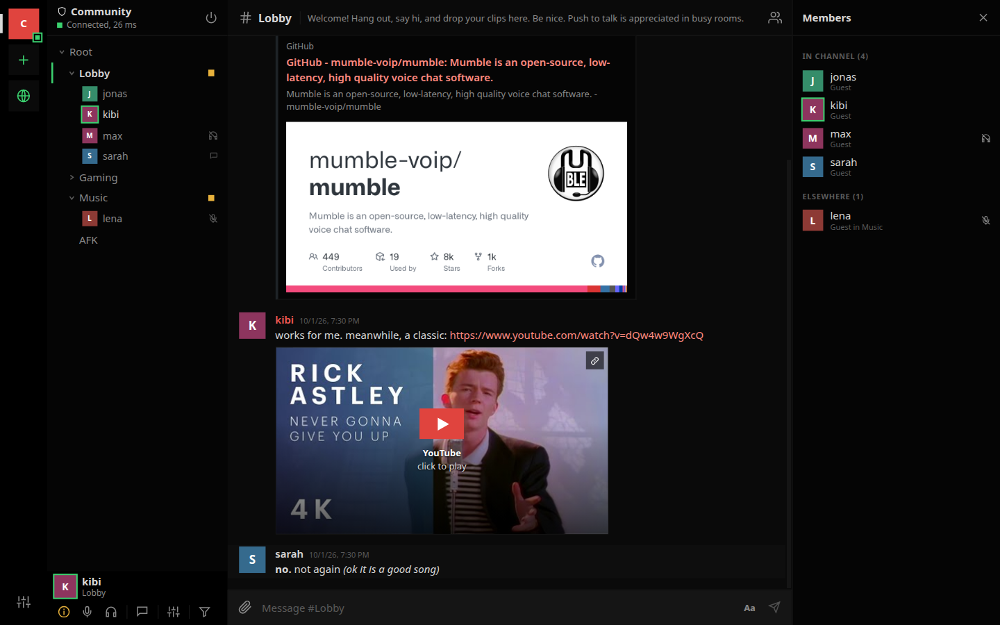
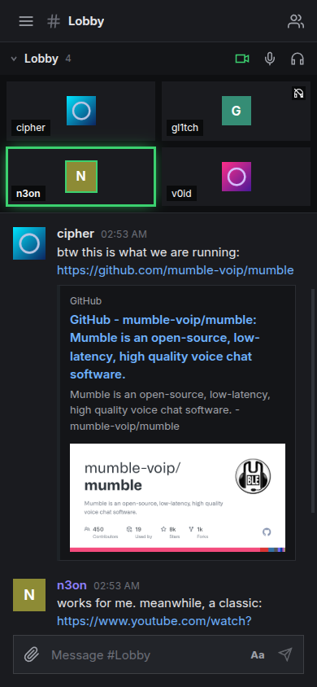

# mumh5

**Mumble, the way it should feel in 2026.**

mumh5 is a modern client for [Mumble](https://www.mumble.info/), the free, open source, low-latency voice chat. It gives Mumble the kind of interface people know from Discord: servers on the left, channels and people in the middle, chat that can do more than text. Underneath, it's plain Mumble, so it connects to **any existing Mumble server** without changing anything on the server side.

Your community keeps its own server, its own rules and its own data. You get an app that's nice to use.



---

## Why mumh5

Mumble has the best foundation of any voice chat: tiny latency, strong encryption, self-hosting, no accounts, no ads, no tracking. What held it back was the desktop client, which still looks and behaves like 2010.

mumh5 keeps the foundation and replaces the experience.

- **Works with the servers you already use.** No plugins, no server changes, no migration. Friends on the regular Mumble client see you and hear you like anyone else.
- **Feels familiar.** A server rail, a channel tree, a real chat with message grouping, profiles, right-click menus everywhere. Anyone who has used Discord knows where things are.
- **Chat that is actually useful.** Drop in files, paste screenshots, share videos and YouTube links. Formatting works, links work, and everything stays compatible with the desktop client.
- **Several servers at once.** Stay in the text chat of every server you like, with unread badges, while voice runs where you actually are.
- **Private by default.** Opening a chat never contacts servers you didn't choose. No remote images or trackers, and YouTube links stay plain links unless you turn on the click-to-play player.
- **Runs everywhere.** Windows, macOS and Linux, with a layout that also works on narrow windows and small screens.

### mumh5 compared to the Mumble desktop client

| | Mumble desktop | mumh5 |
|---|---|---|
| Interface | Qt widgets, dense dialogs | Modern layout (server rail, channel tree, chat, side panels), or the classic and stacked layouts of the desktop client |
| Several servers at the same time | One connection | Many; voice on one, text on all, unread badges |
| Sharing files | Images only, pasted inline and heavily limited | Any allowed file through your own [f0ckm](#file-sharing-with-f0ckm) host, inline players for images, video and audio. Images still work without one |
| YouTube links | Plain links | Plain links by default; optional click-to-play player (privacy mode) and thumbnails |
| Link previews | None | Title, description and image, fetched by your upload host so linked sites never see your IP |
| Chat per channel | One shared log for everything | Separate chats per channel and person, plus a side chat for any channel next to your own |
| Descriptions | Rich text editor | Rich text editor with pictures, and a live size counter against the server limit |
| Identities | One certificate per installation | Several identities, a different one per server if you like; imports your desktop certificate |
| Server certificate trust | Remembered after a warning dialog | Pinned on first use, green header for CA-signed servers, full chain viewer |
| Fast actions in a row | The server silently drops them past its rate limit | Paced to the server's limit, nothing gets lost |
| Right-click on mute or deafen | Nothing | Quick device and volume options |
| Look | One Qt style (plus skins) | Five built-in color schemes, including Windows 95 |
| Channel and permission editing | Dialogs, drag and drop | Same power: create, edit, link, drag and drop, rule and group editor |

**Where the desktop client is still ahead, today:** system-wide push-to-talk, whisper and shout, positional audio, the in-game overlay, recording, and the ban list and registered-user editors. These are on the roadmap below.

---

## Features

### Voice
- Opus voice with voice activity detection, push to talk or always-on
- Live level meter with an adjustable threshold, so you set it once and forget it
- Noise suppression, echo cancellation and automatic gain control
- Microphone and output device selection, input and output volume
- Per-person volume (0 to 300%) and "mute for me"
- Speaking indicators in the channel tree, member list and your own panel
- On small windows, your voice channel appears as tiles above the chat, lighting up as people talk, with mute and deafen at hand
- Low-latency voice over encrypted UDP (Mumble's OCB2-AES128), with automatic fallback to the TCP connection and a TCP-only switch
- Bitrate automatically limited to what the server allows
- Right-click the mute or deafen button for quick device and volume options
- Hear-yourself microphone test



### Channels and people
- Channel tree that starts collapsed; channels with people in them open up
- Single click previews a channel's description, double click joins
- Side chat: write in any channel without leaving yours
- Profiles with rich descriptions (formatting, lists, links, pictures), local nicknames, registration status
- Change your name (mumh5 reconnects for you) and register on a server with one click
- Connection information: ping, packet loss, client version and, for admins, the user's certificate chain
- Moderation from the right-click menu: move, server mute and deafen, priority speaker, kick, ban, register
- Channel management: create, edit, delete, link, and drag and drop channels and people
- Full permission editor: rules per channel with inheritance, groups and members, like the desktop ACL editor
- If you get kicked, you see who kicked you and why, with a Reconnect button



### Screen sharing

- Share a screen or a window with the mumh5 users in your channel; they see an indicator next to your name and click it to watch
- No server setup and no extra account: the setup messages travel through the Mumble server, the picture goes directly between the two clients (WebRTC)
- Picture only for now, up to 8 viewers. Regular Mumble clients do not see streams
- Direct connections mean sharer and viewer see each other's IP address; mumh5 says so before the first use. Behind most home routers a STUN server (Settings, Voice) is needed; none is contacted unless you enter one
- Tested between two desktop instances on one machine; connections across the internet and the browser build are untested

### Chat
- Messages grouped by author, direct messages, unread badges
- File sharing: drag and drop, paste, or the attach button, with upload progress
- Inline images, video and audio players for shared media
- YouTube links as click-to-play players (off by default)
- Link previews with title, description and image; fetched by your upload host by default, so posting a link cannot reveal who reads it
- Incoming HTML is sanitized; remote images from unknown hosts are never loaded
- Messages stay compatible with the desktop client, including picture previews

### Color schemes
Dark, Light, Midnight (true black), Frost, and a faithful **Windows 95** theme with beveled buttons, navy title bars and the teal desktop.

| Windows 95 | Light | Frost | Midnight |
|---|---|---|---|
|  |  |  |  |

### Sounds
- Notification sounds for joins, leaves, messages, mute, push to talk, kicks and more
- Replace any sound with your own file, or load a whole sound pack at once (matched by file name)

### Servers and identity
- Server rail with custom icons, drag-and-drop ordering, connection status and unread counts
- Public server browser with live user counts and ping, like the desktop client
- Several servers connected at once; voice follows the channel you join
- Identity setup wizard: create a new certificate, import a `.p12`, or reuse your desktop Mumble identity
- Password-protected backups of your identity
- Trust on first use for server certificates, a green header for CA-signed ones, and a certificate viewer
- Tray icon that shows whether you are talking, muted or deafened

<p align="center"></p>

---

## Getting started

Download a build from the [releases page](https://git.lat/kibi/mumh5/releases):

| System | File |
|---|---|
| Windows | `mumh5-<version>-win-x64.exe` (installer; not signed yet, so Windows SmartScreen warns once) |
| Linux, any distribution | `mumh5-<version>-linux-x86_64.AppImage` (make it executable, then run it) |
| Debian, Ubuntu | `mumh5-<version>-linux-amd64.deb` |
| Linux, portable | `mumh5-<version>-linux-x64.tar.gz` |

There is no macOS build yet; build it yourself on a Mac (below).

### Running from source

You need [Node.js](https://nodejs.org/) 22 or newer and git.

```bash
git clone gitea@git.lat:kibi/mumh5.git
cd mumh5
npm install
npm run dev
```

On first start, mumh5 asks you to set up your identity. If you already use Mumble on this computer, pick "Use my Mumble desktop identity" to keep your registrations. Then add a server with the plus button.

### Building installers

```bash
npm run dist:linux   # AppImage and .deb
npm run dist:win     # NSIS installer
npm run dist:mac     # .dmg
```

Installers are written to `release/`. The Windows installer also builds on Linux with Wine installed; the macOS one needs a Mac. Pushing a version tag (`git tag v0.1.0 && git push origin v0.1.0`) makes the Gitea workflow in `.gitea/workflows/release.yml` build the Linux and Windows files and attach them to a release.

---

## Browser version

mumh5 also runs in a browser. Browsers cannot open the TLS connection Mumble uses or present a client certificate, so a small proxy you host yourself does that part: it serves the web app and bridges each browser connection to a Mumble server.

```bash
npm ci
npm run build:web      # web app to dist-web/, proxy to dist-proxy/proxy.mjs
MUMH5_SERVERS="mumble.example.com=My server" node dist-proxy/proxy.mjs
```

Then open `http://127.0.0.1:8080`. For development, `npm run dev:web` starts the proxy and a hot-reloading page together, with any server allowed. To deploy, copy `dist-web/` and `dist-proxy/` next to each other on the server (Node 22 or newer, no `node_modules` needed) and put a reverse proxy with HTTPS in front that forwards WebSocket upgrades. Browsers only allow the microphone on HTTPS pages (or on localhost).

| Variable | Default | Meaning |
| --- | --- | --- |
| `MUMH5_SERVERS` | none | Mumble servers people may connect to: `host[:port][=Label]`, comma-separated. Required unless `MUMH5_ALLOW_ANY=1` |
| `MUMH5_ALLOW_ANY` | off | Allow any server on the public internet. Private and loopback addresses stay blocked, except servers listed in `MUMH5_SERVERS` (for a Mumble server on the same machine: `MUMH5_SERVERS=localhost`), or all of them with `MUMH5_ALLOW_PRIVATE=1` |
| `MUMH5_PORT`, `MUMH5_BIND` | `8080`, `127.0.0.1` | Where the proxy listens |
| `MUMH5_ORIGINS` | same host | Origins allowed to use the API, comma-separated, when the page is hosted elsewhere |
| `MUMH5_TRUST_PROXY` | off | Take client addresses from `X-Forwarded-For` (set this behind a reverse proxy) |
| `MUMH5_SEND_PROXY` | off | Announce each visitor's address to the server with the PROXY protocol (see below). Breaks connections to a plain Mumble server |
| `MUMH5_STATIC` | `../dist-web` | Folder with the web build |
| `MUMH5_MAX_CONNECTIONS`, `MUMH5_MAX_PER_ADDRESS` | `200`, `8` | Connection limits, in total and per client address |

Example for nginx. `Host` must be passed on unchanged, because the proxy only accepts requests whose origin matches it. `X-Forwarded-For` carries the visitor's address; start the proxy with `MUMH5_TRUST_PROXY=1` so its per-address limits use it.

```nginx
map $http_upgrade $connection_upgrade { default upgrade; '' close; }

server {
    listen 443 ssl;
    server_name voice.example.com;
    # ssl_certificate and ssl_certificate_key go here

    location / {
        proxy_pass http://127.0.0.1:8080;
        proxy_http_version 1.1;
        proxy_set_header Host $http_host;
        proxy_set_header X-Forwarded-For $remote_addr;
        proxy_set_header Upgrade $http_upgrade;
        proxy_set_header Connection $connection_upgrade;
        proxy_read_timeout 1h;
        proxy_send_timeout 1h;
        proxy_buffering off;
    }
}
```

By default the Mumble server sees every browser user coming from the proxy's address, and that is the address other people and admins get in a user's information. No nginx setting changes that. Bans by IP on the Mumble server would then hit all users of the proxy; ban by certificate instead. In your own information mumh5 shows the address the proxy saw for you, next to the one the server sees.

#### Showing the Mumble server the visitor's real address

Mumble does not understand the PROXY protocol ([mumble#4769](https://github.com/mumble-voip/mumble/issues/4769)), so the only way is to make the connection to it really come from the visitor's address. [go-mmproxy](https://github.com/path-network/go-mmproxy) does this on Linux: it accepts a connection that starts with a PROXY line and opens the connection to the server with that address as the source. It has to run on the same machine as the Mumble server, as root or with `CAP_NET_ADMIN`, with routing rules that send the server's replies back to it:

```bash
# on the Mumble server's machine
ip rule add from 127.0.0.1/8 iif lo table 123
ip route add local 0.0.0.0/0 dev lo table 123
ip -6 rule add from ::1/128 iif lo table 123
ip -6 route add local ::/0 dev lo table 123
go-mmproxy -l 127.0.0.1:64750 -4 127.0.0.1:64738 -6 "[::1]:64738"

# the mumh5 proxy then connects to go-mmproxy instead of Mumble
MUMH5_SEND_PROXY=1 MUMH5_TRUST_PROXY=1 MUMH5_SERVERS="127.0.0.1:64750=My server" node dist-proxy/proxy.mjs
```

The routing rules and options are go-mmproxy's; check its README for your system. mumh5's side (sending the PROXY line) is covered by tests, the go-mmproxy setup itself has not been tested with mumh5. People on the desktop client keep connecting to Mumble directly.

What is different from the desktop app:

- **The proxy is trusted.** Your certificate and its private key are kept in the browser's storage and sent to the proxy on every connect, and everything you send, including the server password, passes through it. Whoever runs the proxy could act as you. Use a proxy you run yourself or trust.
- **Voice goes over TCP.** Browsers have no UDP sockets, so voice uses Mumble's TCP tunnel through the proxy. It works, with more delay on lossy connections.
- **Clearing the browser's data removes your identity.** Download a backup; the same `.p12` file works in the desktop app and in Mumble.
- **Not available:** the public server browser, link previews fetched by your own computer, the tray icon, importing the desktop Mumble certificate automatically.
- Voice needs a browser with WebCodecs audio. It is tested in Chromium only.

## File sharing with f0ckm

Mumble can only carry small inline images. mumh5 can share any file by uploading it to a f0ckm instance (a self-hosted imageboard by the same author) and posting the link. Other mumh5 users get inline players; desktop Mumble users get a normal link plus a small preview.

f0ckm keeps these uploads separate from its imageboard, respects its own list of allowed file types, and deletes them after 30 days by default.

1. On your f0ckm server, create an upload-only key:
   ```bash
   node scripts/chat-upload-key.mjs create mumh5
   ```
2. In mumh5, open **Settings, Chat and files**, enter the f0ckm address and the key, and press **Test key**.

The same host also fetches link previews for you, so the sites people link to never see your IP address.

Without an upload host, mumh5 still sends images, scaled to fit the server's limit, the same way the desktop client does. Link previews can then be fetched directly by your computer if you enable it.

---

## Privacy and security

- **Your identity is a certificate** that stays on your computer, stored with owner-only permissions. mumh5 reminds you to back it up. (The browser version is different, see above.)
- **Server certificates are pinned** the first time you connect. If one changes, mumh5 stops before sending your password and asks you.
- **Chats don't phone home.** Media is only loaded from your upload host and hosts you add yourself. YouTube players are off by default and click-to-play in privacy mode when enabled.
- **Strict content security policy** in the app, and all message HTML is sanitized.

---

## Roadmap

- System-wide push to talk
- Whisper and shout
- Rich chat between mumh5 users: replies, reactions, edits, typing indicators
- Screen sharing: sound (one application or the whole system, also on Linux through PipeWire), quality settings, and an optional self-hosted relay for many viewers
- Release builds for all platforms

---

## Development

```bash
npm run dev          # app with hot reload
npm run check        # type check
npm test             # unit tests
```

Tests against a real Mumble server, including an end-to-end test that drives the app:

```bash
docker run -d --name mumh5-test-murmur -p 64739:64738 -p 64739:64738/udp \
  -e MUMBLE_CONFIG_AUTOBANATTEMPTS=0 -e MUMBLE_SUPERUSER_PASSWORD=testsuper mumblevoip/mumble-server
MUMBLE_TEST_HOST=localhost:64739 npm test
npm run build
MUMBLE_TEST_HOST=localhost:64739 MUMBLE_SUPERUSER_PASSWORD=testsuper npm run test:e2e
npm run build:web && MUMBLE_TEST_HOST=localhost:64739 npm run test:e2e:web   # browser build through the proxy
```

On Linux the end-to-end test forces X11, so it can run on a virtual display: `Xvfb :99 & DISPLAY=:99 npm run test:e2e`. See [CLAUDE.md](CLAUDE.md) for the architecture and project conventions.

```
electron/   main process: window, TLS sockets, identities, tray
src/core/   Mumble protocol: framing, codec, client state, voice packets
src/lib/    app state, voice engine, sanitizing, uploads
src/ui/     Svelte components
proto/      Mumble.proto and MumbleUDP.proto from upstream
test/       unit, server and end-to-end tests
```

---

## AI disclosure and credits

mumh5 is built by **Kibi** together with **Claude**, Anthropic's AI model, working in Claude Code.

Kibi sets the direction: what mumh5 should be, how it should look and feel, which trade-offs to make, and whether a result is good enough. Claude writes most of the code, the tests and this documentation, and checks each feature against a real Mumble server before calling it done. Commits written with Claude carry a `Co-Authored-By: Claude` line.

We say this openly because you should know how the software you run was made. Features are covered by automated tests, including end-to-end tests against a real Mumble server. If something is wrong, please open an issue.

## License

[MIT](LICENSE). The Mumble protocol definitions in `proto/`, and the code generated from them, are licensed by The Mumble Developers under a BSD license; see [THIRD_PARTY_NOTICES.md](THIRD_PARTY_NOTICES.md).

mumh5 is not affiliated with the Mumble project. Mumble is a trademark of its respective owners.
